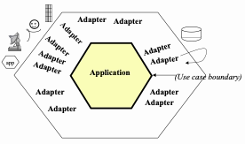
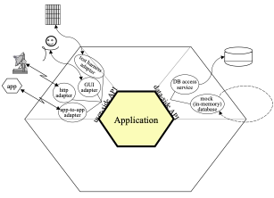
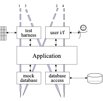
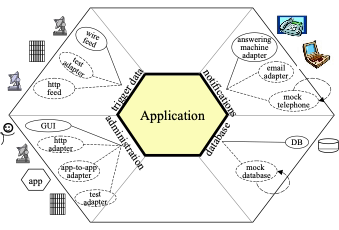

# Hexagonal (Ports & Adapters) Architecture

Source: Alistair Cockburn, alistair.cockburn.us, https://alistair.cockburn.us/hexagonal-architecture
(HaT Technical Report 2005.02, 2005-09-04, v0.9, to be updated after reader comments)

- Build the application to work without a UI or a database. This allows automated regression tests,
  keeps it working when the database is unavailable, and lets applications link together without
  user involvement.
- Pattern: Ports and Adapters (Object Structural). Alternative name: Hexagonal Architecture.

## Intent

- The application can be driven equally by users, programs, automated tests or batch scripts. It can
  be developed and tested in isolation from its eventual run-time devices and databases.
- Inbound events arrive at a port. A technology-specific adapter converts each one into a procedure
  call or message for the application. The application does not know what the input device is.
- Outbound: the application sends through a port to an adapter, which creates the signals the
  receiving technology (human or automated) needs.
- The application interacts with adapters on all sides in a semantically sound way, without knowing
  what lies beyond them.

## Motivation

- Business logic leaking into UI code causes three problems:
  - The system can't be cleanly tested by automated suites, because the logic depends on
    oft-changing visual details such as field size and button placement.
  - It can't be shifted from human-driven use to batch runs.
  - It can't easily be driven by another program.
- A common attempted fix is a new layer that promises to hold no business logic. Nothing detects
  violations, so a few years later the layer is cluttered with business logic again.
- If every function is available through an API:
  - QA can run automated tests to detect regressions.
  - Business experts can write automated tests before the GUI is finalised. These tell programmers
    when the work is correct and become the test department's tests.
  - The application can run headless, so other programs can use it. This simplifies application
    suites and lets B2B services use each other over the web without humans.
  - Automated regression tests detect business logic leaking into the presentation layer, so the
    leak can be found and fixed.
- A similar problem exists on the "other side": when application logic is tied to an external
  database or service, programmers can't work if it goes down or is reworked or replaced. This
  causes delay costs and often bad feelings between people.
- The two problems don't look related, but the solution shows a symmetry between them.

## Nature of the Solution

- Both problems have the same cause: business logic entangled with interaction with external
  entities.
- The asymmetry to exploit is inside vs outside, not left vs right. Rule: inside code must not leak
  into the outside part.
- The application talks over ports to external agencies. "Port" evokes OS ports and gadget ports,
  where any device that follows the protocol can plug in. The purpose of the conversation sets a
  port's protocol, which takes the form of an API.
- Each external device has an adapter that converts between the API and the device's signals.
  - User side: a GUI (maps a person's movements to the port API), test harnesses such as FIT or
    Fitnesse, batch drivers, and code for communication between applications across the enterprise
    or net.
  - Data side: the protocol is typically a database protocol. Moving from SQL to a flat file or any
    other database should not change the API conversation. Adapters include SQL, flat file and, most
    importantly, an in-memory mock database that doesn't need the real one.
- Many applications have only two ports (user side and database side). This makes them look
  asymmetric and invites a one-dimensional 3-, 4- or 5-layer stacked architecture. Layer drawings
  have two problems:
  - Worst: people don't take the layer lines seriously and let logic leak across them.
  - There may be more than two ports, which doesn't fit a one-dimensional layer drawing.
- Hexagonal architecture fixes this by noting the symmetry: an application inside, communicating
  over some number of ports with outside items, which can be treated symmetrically.
- The hexagon highlights:
  - (a) the inside-outside asymmetry and the similar nature of ports, away from the layered picture;
  - (b) a defined number of ports: two, three or four (four is the most the author has met).
- Six sides don't matter. The shape leaves room to draw ports and adapters as needed.
- "Ports and adapters" names the parts' purposes. A port is a purposeful conversation and typically
  has multiple adapters, e.g. phone answering machine, human voice, touch-tone phone, GUI, test
  harness, batch driver, http interface, program-to-program interface, mock in-memory database, real
  database (perhaps different ones for dev, test and real use).
- The left-right asymmetry returns in the Application Notes. The pattern's primary focus is
  inside-outside, treating all external items as identical for now.

## Structure

- Figure 2: two active ports (application-controlling side and data-retrieval side), each with
  several adapters.
  - Driven equally by an automated system-level regression suite, a human user, a remote http
    application or another local application.
  - Data side: runs against an in-memory oracle or mock database, or a test or run-time database.
- Write the functional specification (perhaps use cases) against the inner hexagon's interface, not
  against any external technology.

- Figure 3 maps the same application to three layers, with two adapters per port in the top and
  bottom layers. A typical development order:
  1. FIT test harness driving the app, with the mock (in-memory) database.
  2. GUI added, still on the mock database.
  3. Integration testing: automated scripts (e.g. from Cruise Control) against a real database with
     test data.
  4. Real use: a person using the app against a live database.

## Sample Code

- Example from the FIT documentation: `discount(amount) = amount * rate(amount)`. The amount comes
  from the user and the rate from a database, so there are two ports. Code by Gyan Sharma (IHC).
- Built in stages: tests with a constant rate instead of a mock database; then GUI; then a mock
  database that can be swapped for a real one.

### Stage 1: FIT + App + constant-as-mock-database

- Test cases are an HTML table (TestDiscounter: amount 100 → discount 5; 200 → 10). Column names
  become class and function names. FIT can remove this "programmerese", but the article leaves it.
- User-side adapter: a FIT `ColumnFixture` subclass `TestDiscounter` that holds a `Discounter` and
  has `discount()` return `app.discount(amount)`. That is the whole adapter.
- Tests run from the command line via `fit.FileRunner`. FIT outputs a colour-coded pass/fail file.
- The code is then ready to check in and add to the Cruise Control / automated build-and-test suite.

### Stage 2: UI + App + constant-as-mock-database

- A UI (code mostly left to the reader) whose `actionPerformed` parses the text field, calls
  `app.discount(amount)` and displays the result.
- Both user-side adapters now run, so the app can be demoed and regression tested.

### Stage 3: (FIT or UI) + App + mock database

- Replaceable database-side adapter: an interface
  `RateRepository { double getRate(double amount); }`, a `RepositoryFactory` that produces the mock
  or the real service object, and `MockRateRepository` (rate 0.01 if ≤100, 0.02 if ≤1000, else
  0.05).
- `Discounter` takes a `RateRepository` in its constructor; `discount` returns
  `amount * rateRepository.getRate(amount)`.
- The user-side adapter (FIT or UI) passes the repository (mock or real) into the app's constructor,
  e.g. `new Discounter(RepositoryFactory.getMockRateRepository())`. The FIT code that chooses mock
  or real is omitted as longer but not informative.
- This completes the simplest version of the hexagonal architecture.

## Application Notes

### The Left-Right Asymmetry

- The pattern deliberately treats all ports as similar, which is useful at the architectural level.
  In implementation, ports and adapters come in two flavours: primary (driving) and secondary
  (driven).
- In all the examples, FIT fixtures sit on left-side ports (top layer) and mocks on the right
  (bottom layer).
- This matches use-case primary and secondary actors:
  - A primary actor drives the application, taking it out of quiescence to perform an advertised
    function.
  - A secondary actor is driven by the application, to get answers or just be notified.
  - The difference is who triggers or controls the conversation.
- FIT is the natural test substitute for a primary actor, because it reads a script and drives the
  app. A mock is the natural substitute for a secondary actor such as a database, because it answers
  queries or records events.
- So, following the use case context diagram, draw primary ports and adapters on the left (or top)
  and secondary ones on the right (or bottom).
- Treat the FIT/mock correspondence as a consequence of the architecture, not a shortcut around it.
  The ultimate benefit is running the application fully isolated.

### Use Cases And The Application Boundary

- The pattern reinforces the preferred way to write use cases.
- A common mistake is use cases containing intimate knowledge of the technology outside each port.
  These have a justifiably bad name: long, hard to read, boring, brittle and expensive to maintain.
- Write use cases at the application boundary (the inner hexagon), specifying functions and events
  regardless of technology. These are shorter, easier to read, cheaper to maintain and more stable.

### How Many Ports?

- What counts as a port is largely taste. Extremes: one port per use case (hundreds), or all
  primaries and all secondaries merged into two. Neither seems optimal.
- Examples:
  - Weather system: four ports (weather feed, administrator, notified subscribers, subscriber
    database).
  - Coffee machine controller: four (user, recipes-and-prices database, dispensers, coin box).
  - Hospital medication system: three (nurse, prescription database, computer-controlled medication
    dispensers).
- Choosing the "wrong" number doesn't appear to do particular damage, so it is a matter of
  intuition. The author favours a small number: two, three or four.

## Known Uses

- Figure 4: a four-port system that listened for national weather service alerts (earthquakes,
  tornadoes, fires, floods) and notified people by telephone or answering machine.
  - Its interfaces were identified by technology linked to purpose: wire-feed trigger data,
    notifications to answering machines, an admin GUI, and a subscriber database.
  - The team needed to add an http feed from the weather service and email to subscribers, and to
    bundle or unbundle the suite to suit how different customers bought it. They feared
    implementing, testing and maintaining separate versions for every combination.
  - The fix was to design interfaces by purpose, not technology, with technologies on all sides
    substitutable by adapters. The http feed and email were added immediately (dashed lines in the
    figure).
  - Running headless through APIs let them add an app-to-app adapter, unbundle the suite and connect
    sub-applications on demand.
  - Running fully isolated with test and mock adapters gave stand-alone automated regression tests.

### Mac, Windows, Google, Flickr, Web 2.0

- In the early 1990s, Macintosh applications (e.g. word processors) had to be API-drivable, so
  applications and user scripts could access all functions. Windows desktop apps evolved the same
  ability (the author doesn't know which came first; it isn't relevant).
- The 2005 web trend is to publish APIs for other web apps, e.g. local crime data on a Google map,
  or apps that include Flickr's photo archiving and annotation.
- All of these expose primary ports' APIs. They say nothing about secondary ports.

### Stored Outputs

- Willem Bogaerts (C2 wiki): his application layer acted like a telephone switchboard. It generated
  output, buffered it, showed it to the user, then stored it only if the user chose to.
  - Fix: a presentation control with storage facilities. The app just outputs to the control, which
    buffers the output and offers storage.
  - Layered architecture treats "UI" and "storage" as different. Ports and adapters can reduce both
    to plain "output".

### Anonymous example from the C2-wiki

- A project used the system metaphor of a component stereo: each component has purpose-specific
  interfaces, and components connect in almost unlimited ways via simple cables and adapters.

### Distributed, Large-Team Development

- Still in trial use, so not a proper use of the pattern yet.
- Teams in different locations build to the hexagonal architecture, using FIT and mocks so
  components test standalone. CruiseControl builds every half hour, running all apps with FIT +
  mocks. Mocks are replaced by test databases as subsystems and databases are completed.

### Separating Development of UI and Application Logic

- In early trial use, so not a use of the pattern yet.
- The UI technology and metaphor are undecided. The back-end services architecture is undecided and
  will probably change several times over the next six months. The project has started anyway.
- The application team uses FIT tests and mocks to isolate the app and show users testable,
  demonstrable functionality. Adding the UI and back end once decided "should be straightforward".
  The outcome is not yet known.

## Related Patterns

- **Adapter** (_Design Patterns_: "Convert the interface of a class into another interface clients
  expect"). Ports and adapters is a particular use of it.
- **Model-View-Controller**: implemented as early as 1974 in Smalltalk. Its variants (e.g.
  Model-Interactor, Model-View-Presenter) apply ports and adapters to primary ports only, not
  secondary ones.
- **Mock Objects and Loopback**:
  - MockObjects.com: a mock is a "double agent". It fakes an interface or class's external
    behaviour, observes how other objects call it and compares that with preset expectations. It
    interrupts the test on a discrepancy, or a verification method called by the tester reports
    unmet expectations.
  - The full mock-object agenda uses mocks throughout an application, not just at external
    interfaces. Its main focus is conformance to protocol at class and object level. Cockburn
    borrows "mock" to mean an in-memory substitute for an external secondary actor.
  - Loopback: an explicit pattern for an internal replacement of an external device.
- **Pedestals** (Barry Rubel, "Patterns for Generating a Layered Architecture"):
  - Creates an axis of symmetry in control software and is very similar to ports and adapters. It
    implements an object per hardware device, linked in a control layer.
  - It can describe either side of the hexagon but doesn't yet stress the similarity across
    adapters. It was written for mechanical control, so applying it to IT applications is less
    obvious.
- **Checks** (Ward Cunningham): a pattern language for detecting and handling user input errors.
  Good for error handling across the inner hexagon boundaries.
- **Dependency Inversion / Dependency Injection and SPRING**:
  - Bob Martin's DIP (called Dependency Injection by Martin Fowler): high-level modules shouldn't
    depend on low-level ones; both should depend on abstractions; abstractions shouldn't depend on
    details, and details should depend on abstractions.
  - Fowler's Dependency Injection pattern gives implementations that show how to make secondary
    actor adapters swappable. The code can be written directly, as in the sample, or generated by
    SPRING from configuration files.

## Acknowledgements

- Rebecca Wirfs-Brock's _Object Design_, read together with the _Adapter_ pattern from _Design
  Patterns_, helped the author understand the hexagon. Ward's wiki contributors (e.g. Kevin
  Rutherford's "Hexagonal Soup") commented on the pattern over the years.

## References

- FIT (Cunningham; Mugridge & Cunningham, _Fit for Developing Software_, 2005); Adapter (Gamma et
  al., _Design Patterns_, 1995); Pedestal (Rubel, in _Pattern Languages of Program Design_, 1995);
  Checks (Cunningham); Dependency Inversion Principle (Martin, _Agile Software Development_, 2003,
  ch. 11); Dependency Injection (Fowler); Mock Object (Freeman); Loopback (Cockburn); use cases
  (Cockburn, _Writing Effective Use Cases_, 2001; "Structuring Use Cases with Goals").
