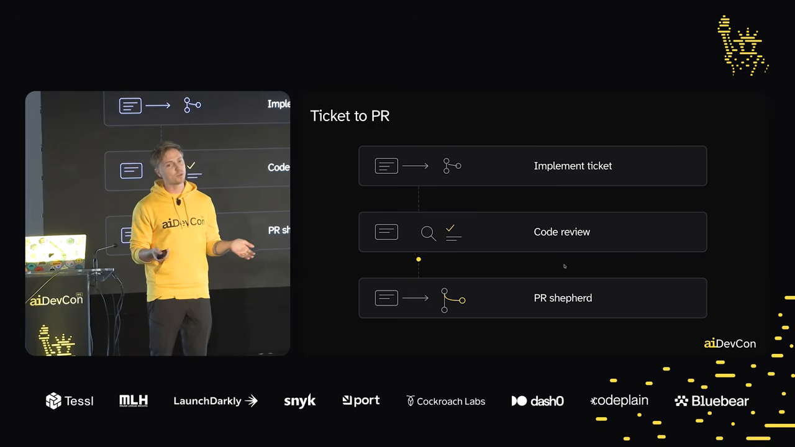
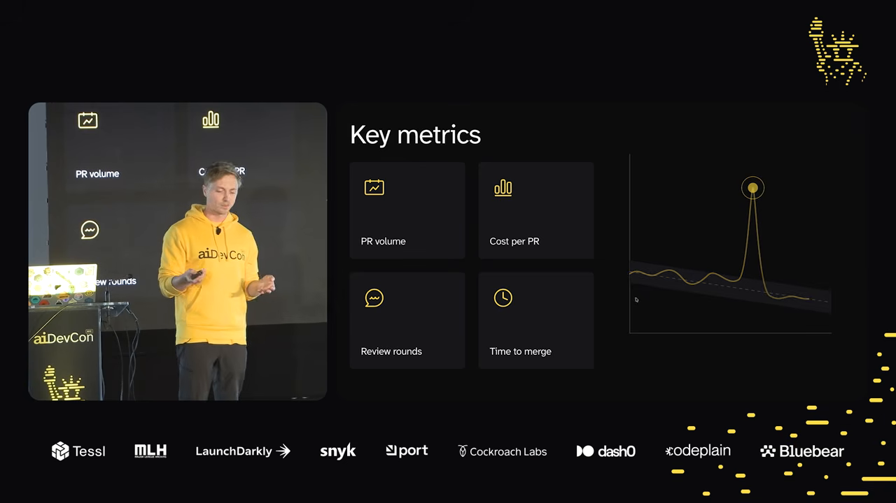
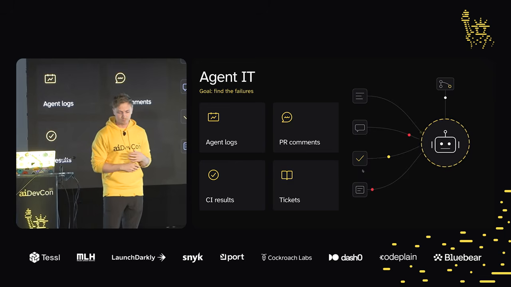
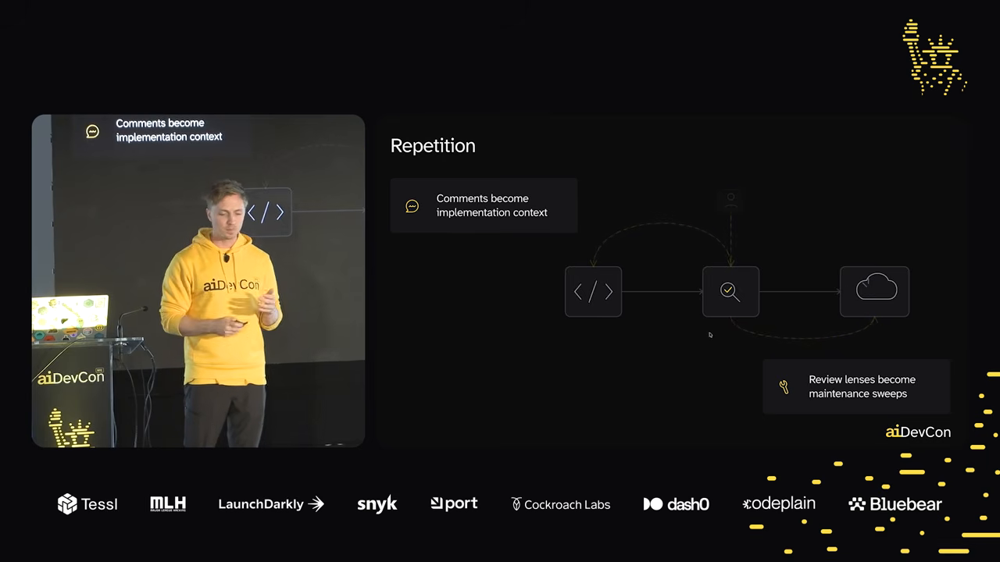
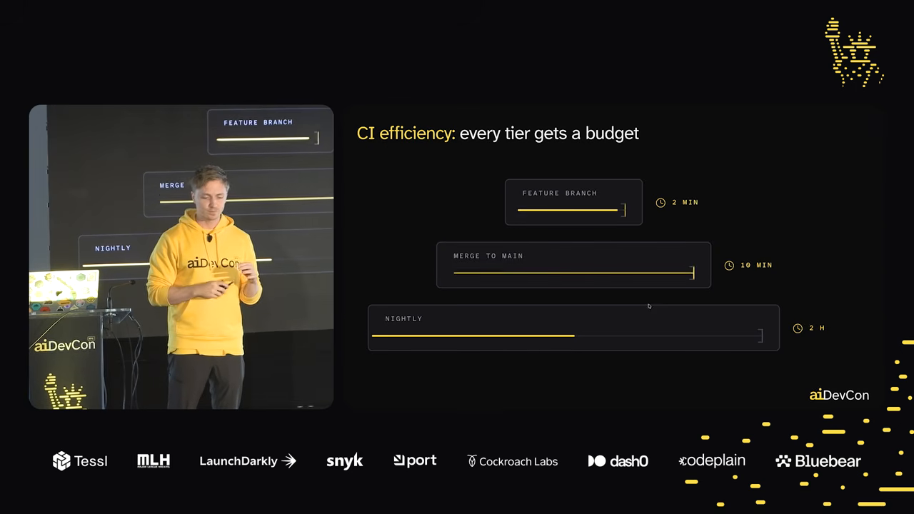
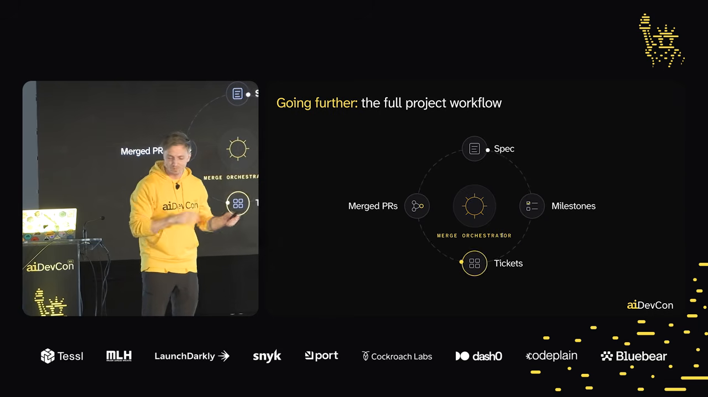

# Dru Knox on the First 5 Problems Every Factory Hits

Source: Dru Knox, Tessl | AI Native Dev, https://www.youtube.com/watch?v=RQerOLmFiiE

Talk at aiDevCon London by Dru Knox, Head of Product & Design at Tessl.

## Framing

- Knox dislikes the term "dark factory"; prefers "light factory" or just "factory".
- The talk is a hands-on look at the first five problems teams hit when building with a factory, how
  to solve them, and what factory work looks like as an engineering discipline.

## What a software factory is

- At its most basic, a factory is ticket to PR:
  - Issues are filed in the tracker and handed to a cloud sandbox, where an agent runs unsupervised
    and opens a PR.
  - Humans leave feedback on the PR. The agent addresses it, possibly using CI signals, until the PR
    is mergeable, then it merges.
- Knox argues a factory is more a discipline than a feature, though that feature enables it.
- Four pillars:
  - **Legible, public work:** all work happens in shared places (issues, PRs). Feedback and agent
    traces aren't left on one person's machine. This is the most painful change because people have
    personal setups. Knox, a Neovim die-hard, kept trying to build every workflow into Neovim. The
    point is shared learning: once one person hits a problem, no one else hits it again.
  - **Fix the process, not the code:** at Tessl every PR must first be attempted in one shot. If it
    fails, before commenting, the engineer checks whether an environment change would have produced
    a one-shot result (more tests, extra context, extra lint rules) and tries that at least once.
    Only when that proves insufficient is the code corrected through PR comments.
  - **Automate repetition:** anything done more than once should prompt automation, with a
    significant share of the work week set aside for it. Boris Cherny (Claude Code) reportedly
    spends every Friday reviewing his week's work and automating it.
  - Ticket to PR makes this way of working the default and covers all four pillars at once.

## The three ticket-to-PR loops

- Nothing magical, but a lot of toil and plumbing behind the scenes.
- **Delegate:** a ticket goes to a cloud sandbox where an agent, with the environment and
  permissions it needs, checks out the repo, makes changes and opens a PR. A one-page skill usually
  covers the instructions.
- **Code review:** agents review the PR. This doesn't mean no human reads the code. It can run as a
  CI action or locally.
  - Many people find GitHub CI breaking often, so some move review to local runs. That leaves the
    legible surface, which is risky unless review rounds are captured some other way.
- **PR shepherd:** watches CI results and agent and human comments, addresses them and pushes
  changes. Review and shepherd alternate until they converge. A human may do a final pass and merge.
- This setup is powerful but breaks quickly. Fixing one problem earns new bottlenecks.
- In Knox's and Tessl's experience, the factory mindset is when "gravity" starts pulling forward
  instead of back. Every problem now has a known solution shape: loops that read signals and metrics
  and propose changes on a schedule. Unpredictable breakage becomes ordinary engineering problems
  with known tools.
- Knox disagrees with "coding is dead, we'll all be PMs". That can feel true with local Claude use.
  Factory work is still coding, just without typing code: building DAGs, designing system
  architecture, debugging traces. It reaches flow state, feels like engineering at a different level
  of abstraction, and is fun.

## Metrics

- PR velocity will shoot up. Observability drops because agents ship a lot of code humans weren't
  close to as it was built, so metrics are needed.
- Use the metrics for diagnosis, not as targets. Track the baseline: divergence usually means a
  problem, such as a sharp dip in PR volume. Directional trends with all else steady are good, e.g.
  rising PR count. Knox can't say whether 50 or 500 PRs a week is good for a given organisation.
- **PR volume:** how much work goes through.
- **Cost per PR:** should fall over time. Baselines Knox has heard range from $10 to $30 to $50 per
  PR. In his view it is the best leading indicator: when something breaks it spikes fast, because
  agents churn, get stuck in review loops, or spend 30 extra minutes on a system they lost access
  to. Pin it to the dashboard.
- **Review rounds:** a sidecar to cost per PR. About half of cost per PR typically goes to review.
  Three to five rounds, or 60-70% of cost in review, suggests inefficiency or slop. Aim for 30-40%,
  with one round catching most issues.
- **Time to merge:** platform stability and capacity. A rise can mean resources need provisioning,
  or that agents have swarmed a problem. Agents run into the fire and "light more matches", so
  backlogs and latency often signal that agents are hitting a problem.

## The first five problems

- Not guaranteed to be the first five, but customers and Knox reliably hit them.
- The general fix: an automated loop runs on a cadence, reads signals and proposes changes for
  review.
- **Agent IT:** every system you didn't know you needed or used casually. By far the first problem
  hit: configuring access, deciding what to trust, getting keys in place. You think you look at five
  things but actually look at 50, and the agent needs all of them.
- **Code quality:** the fear of slop. The focus here is architectural quality.
- **Repetition:** cycles spent correcting the same issues. Nobody makes time to automate.
- **Test quality:** agents love writing tests, including useless ones. The risk is bloat.
- **CI:** hit by many people in the last month or two. Anthropic reportedly had to rebuild its
  source control, and GitHub is struggling. CI runs of 15-30 minutes cripple everything else.

## 1. Agent IT

- Goal: find the small failures where agents lack access or work inefficiently.
- Tessl example: agents couldn't work with the Linear API, even with docs. They wasted 5-6 rounds
  getting parameters right. A simple script for the needed lookups fixed it. It had to be noticed
  first, though, because PRs were still being opened and the waste was visible only in traces.
- Agent logs are the most important signal. Ticket to PR doesn't provide them for free: logs must be
  aggregated into a data lake and made available to automations.
- Easier signals: PR comments, CI results, filed tickets.
- Run a loop (Tessl runs it nightly) that scans these for failure patterns: very long traces and
  runs, CI failures. It makes straightforward recommendations, either:
  - a ticket with evidence (e.g. "10 of 50 sessions today got stuck on Linear; write a script"), or
  - a PR to review or auto-merge. Tessl auto-merges these because they touch only the internal
    factory, so breakage doesn't affect users.

## 2. Code quality

- Beyond bugs and deeply nested conditionals, the biggest agent problem Knox sees is very long files
  that are clearly god modules.
- Good architecture is hard to codify as a static check. Two metrics catch most issues, or at least
  prompt the agent to look, and it can usually work out what's wrong:
  - **Line count** ("embarrassingly dumb"): a CI flag or evening loop for files over 1,000 lines
    asks the agent whether the file needs to be that long.
  - **Method cohesion:** cluster a file's symbols and look for clusters with little overlap.
    Example: methods using a user object and methods using a home object, with few methods touching
    both. Told there are two clusters, the agent almost immediately splits them into user and home
    modules.
- These two together keep architecture fairly sane. Beyond them, use component-specific metrics.
- Module ownership, such as defining what health looks like for Tessl's LiteLLM gateway, becomes a
  bigger part of the job and feels like software engineering again. Metrics can be specific to the
  company's own instance. Once they exist, agents don't make mistakes that break them.
- Other metrics:
  - **Fan-in/fan-out** (parameters taken, dependencies): most useful in high-churn areas, e.g. files
    touched daily with high fan-in/fan-out.
  - **Comment count:** agents love comments. Tessl's comment share once grew about 5% a week. A
    "comment diet" loop now reduces it continually.
  - **Complexity:** catches some issues, but far less of a catch-all than hoped.
- None of these are hard checks, only nudges. Agents don't consider these problems unprompted, but
  when asked they usually find a good answer, producing PRs that take less time to review.

## 3. Repetition

- Things you or agents say over and over.
- **Shift left:** an evening loop reviews frequent PR comments from both agent reviewers and humans,
  finds patterns, and updates the code base or its context so agents get it right first time. This
  helps cost, quality and review time.
- **Shift right:** nightly, hourly or other scans apply review learnings to catch what slipped
  through. These are belt and braces as human review rigour drops or larger PRs let more through.

## 4. Test quality

- The first three problems get noticed quickly. Test quality can stay invisible for a long time:
  while everything passes and bugs are few, useless tests pile up unseen.
- **Under-testing:** agents can hit 90%+ coverage targets with tests that test nothing real.
  Mutation testing (break the code, check whether tests catch it) finds code that is well covered
  but not well tested, i.e. its behaviour isn't exercised.
- **Over-testing and flakiness:** agents love real-world fixtures that use file systems, or git
  harnesses that break or have race conditions. Tessl has no great metrics for this yet. A nightly
  test-health review asked to find over-testing tends to find it. Examples: testing something that
  wouldn't compile if broken, and common flakiness sources. This pays down the debt.
- Goal: a test suite that is robust but small enough not to cripple CI.

## 5. CI

- The last big problem. Once solved, the factory can really accelerate.
- Agents speed up test growth (the meme: a 100,000-line diff with 50,000 lines of tests).
- Split tests into buckets, each with a time budget:
  - **Feature branches:** quick, loose, non-exhaustive tests that run in one to two minutes and stop
    issues accumulating.
  - **Merge to main:** standard unit tests. Agents tend to write "unit tests" that are really
    integration or end-to-end tests taking 10 minutes serially (e.g. installing Playwright).
  - **Nightly:** end-to-end tests with Playwright etc. Budget can be an hour or two.
- Nightly loops give agents the budget as a target ("if this area of CI exceeds X, get it below Y").
  Agents are great at grinding against a number.
- Tell agents the buckets exist. Their impulse to fill testing gaps is good. With the buckets known,
  they put end-to-end tests in the nightly run instead of CI, avoiding 30-minute runs on every PR.

## Orchestrating larger work

- With these problems handled, most people move on to orchestrating larger amounts of work.
- Knox's lifecycle:
  - **Spec:** written interactively with an agent, often by voice while running.
  - **Spec to milestones:** probably the earliest stage worth automating. Agents, especially
    "Fable-class" models, are good at splitting a spec into vertical milestones with acceptance
    criteria. A loop takes a spec ticket and breaks it into milestones, then implementation tickets.
    Knox says hand-crafting the plan is largely over with these bigger agents.
  - **PR merge shepherd:** recommended. On every merge it checks the issue tracker for what comes
    next and whether upcoming tickets need updating, e.g. after an API contract changed.
- Combined, the flow can run while away from the desk, e.g. out in Barcelona: talk a spec through
  with an agent, approve milestones on the bus, a feature branch kicks off, review the code (maybe
  via a video walkthrough), request tweaks, merge, and the next ticket starts.

## Recommendations

- Start by setting up ticket to PR. It is "crossing the Rubicon": agents become the way to solve
  agent problems.
- Establish baseline metrics, then fix problems as they appear.
- Tessl is offering free credits to try this.

## Q&A

- **Test tooling and context:** the asker found tests better when a separate agent writes them, not
  the one writing the code. Knox, mostly a TypeScript developer:
  - Has the agent do red-green TDD, which he never made himself do.
  - Uses Stryker for mutation testing and calls it the biggest level-up. Agents don't tire, so it's
    now practical.
  - Tried mutation testing in PR CI ("kind of crazy"). Now runs it nightly across the whole repo,
    filing follow-up issues for uncaught mutants. This made tests catch real issues. His top tip.
- **Under-specified tickets:** the factory is for shaped work, not for shaping it. Used for shaping,
  it disappears for five minutes and returns with one more question. Knox shapes work interactively
  with a local agent, then files a ready-to-go ticket and starts it.
- **Nightly batching for token efficiency:** Tessl does little batching. Latency to a PR for one
  issue can exceed working directly in Claude Code. Better to run several parallel streams and check
  in than to chase speed. The one real loss is needing to multitask more, but timing check-ins well
  makes it work. Time to merge is not a target, only a signal: a change means something in the
  pipeline is broken.
