# Guy Podjarny: Building a Software Factory You Can Trust

Source: Guy Podjarny, AI Native Dev, https://www.youtube.com/watch?v=3NH_i8M1Gqg

Opening keynote, AI DevCon NYC 2026. Podjarny (Guypo) is founder and CEO of Tessl.

## Setting the stage

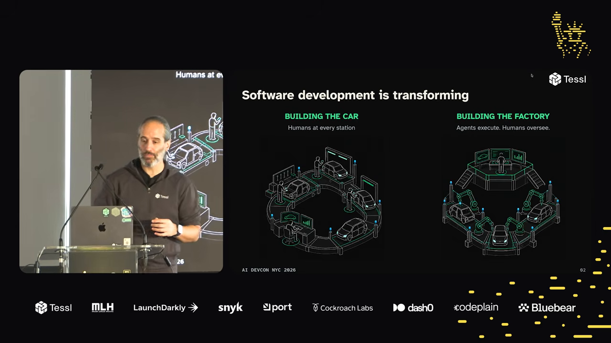

- Software development is moving from building the car to building the factory.
- Before: repeatable stations (design, implement, review, test), each worked by a human, perhaps
  with some help.
- Now: the stations are much the same, but AI agents ("robots") work them. The human supervises and
  learns how to run the factory well.
- Industry data shows the move pays off:
  - Meta cut incident rates 50x with AI code reviews.
  - Stripe 10x'd PRs per week, to 23 PRs per developer per week.
  - GitHub sped up remediation.

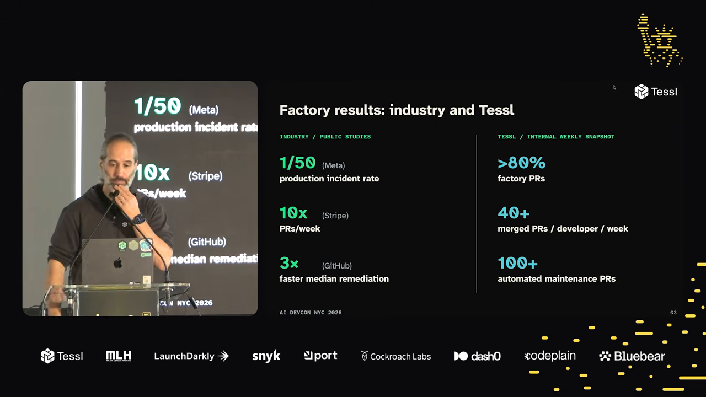

- Tessl has used software factories heavily since last spring:
  - More than 80% of its PRs never touched a desktop; they went from ticket to PR to merge.
  - It merges 40+ PRs per developer per week, faster than Stripe, though Tessl is smaller.
  - Getting there took work, and the pace compounds.
  - The factory also does a lot of automatic maintenance: grunt work that makes the software more
    secure, reliable, clean and high-quality.

## Concerns: quality, cost, safety

- Most pushback against factories falls into three buckets:
  - **Quality:** will the software be AI slop the agents made up?
  - **Cost:** most people have had an agent run up a bill they didn't intend.
  - **Safety:** recent months have seen many incidents of rogue agents.

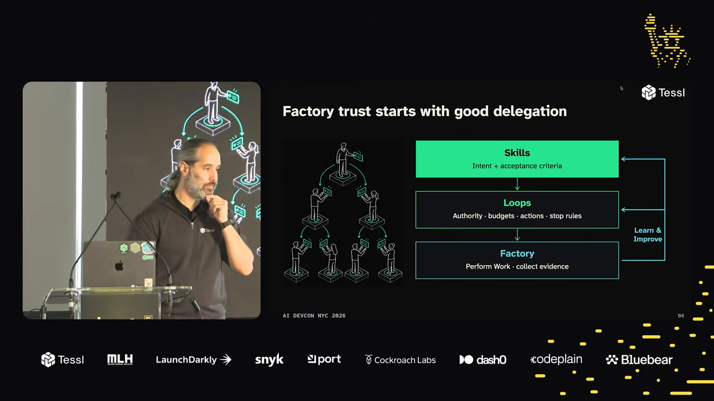

- These match a manager's worries about a team: quality, cost or time, and things going badly.
- Managers handle them by delegating well:
  - Define the outcome and what good looks like. Without that, results depend on luck.
  - Delegate inside boundaries: budget, tools, security limits.
  - Observe, learn, and adjust expectations, tools and boundaries, so the organisation evolves.
- Factories need the same:
  - Define skills: what to do and what good looks like.
  - Run them in loops with boundaries: environment, budget, guardrails.
  - Observe and keep evolving: sharpen what you want, improve and add tools.

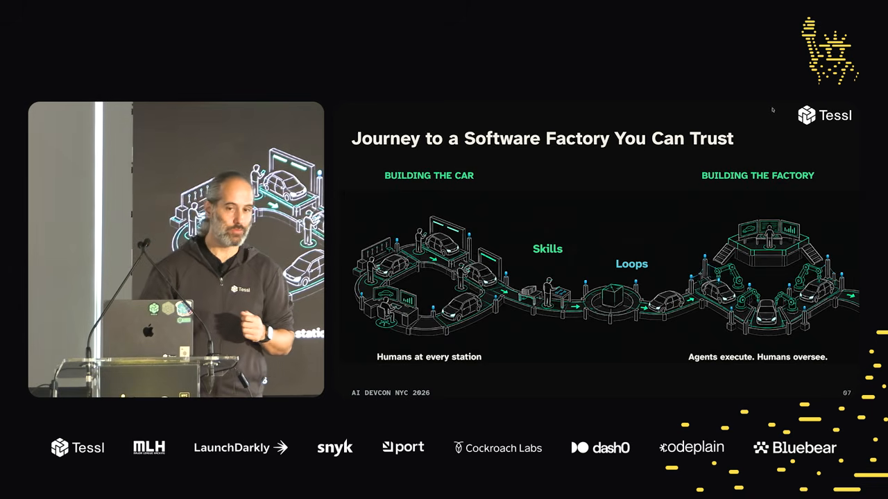

- Thesis: a trustworthy factory comes from going skills, then loops, then factory.

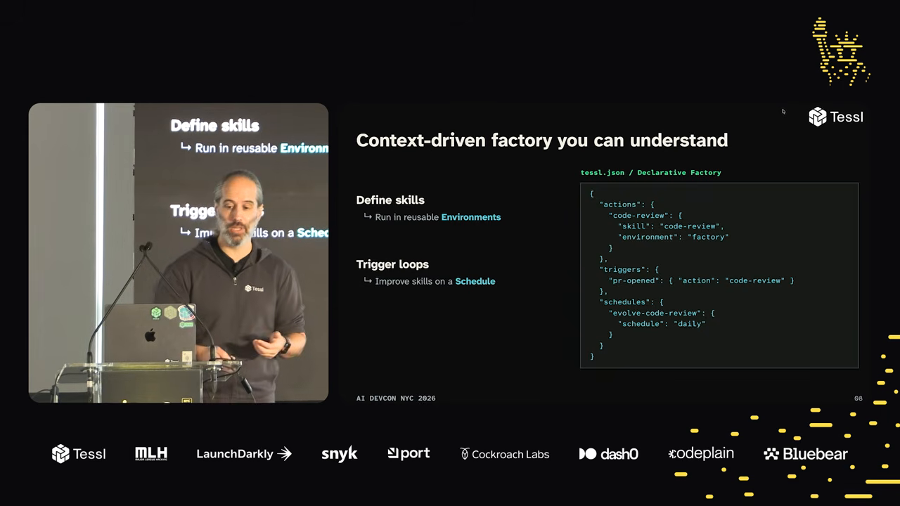

- This also makes the factory understandable. Many factories today are themselves slop: piles of
  scripts and automations.
- The skill-centric structure:
  - Skill + environment = action.
  - Action + trigger (event or schedule) = loop, which is easy to reason about.
  - Composed loops = business outcomes. Example: ticket to PR is made of four loops.

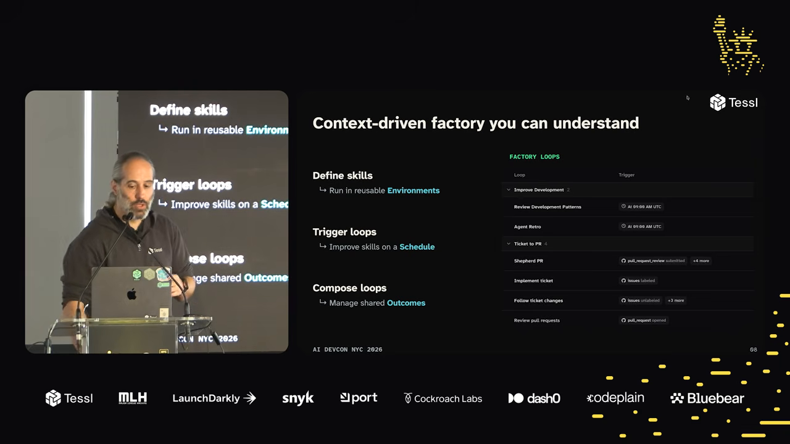

## What "factory" means

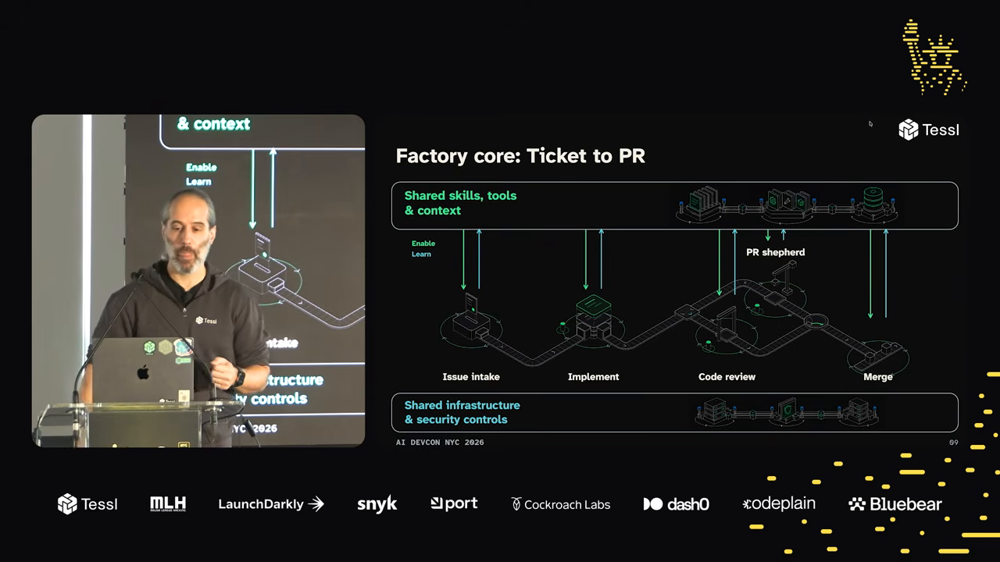

- The term has many interpretations. At a high level, a factory automates the whole SDLC.
- In practice it mostly means the ticket-to-PR flow, moving from local building to an automated
  system:
  - An issue is logged.
  - An agent implements it.
  - An agent reviews it, perhaps with a human too.
  - An agent responds to the reviews.
  - The PR is merged once good enough.
- Shared components (skills, tools, context) feed each stage.
- Self-improvement: learn from runs and improve those skills, tools and context.
- Shared infrastructure: sandboxes, telemetry, other components.

## Skills

- The case for skills is shown through a different workflow: automated vulnerability remediation.
- "Black October" brought mega vulnerability disclosures:
  - Top headline: the PHP-to-shell flaw, about 3 years old, now disclosed. It is a remote command
    execution that is trivial to exploit.
  - GitLab had a couple of similar flaws.
  - Microsoft set a record with 1,400 fixes in one Patch Tuesday.

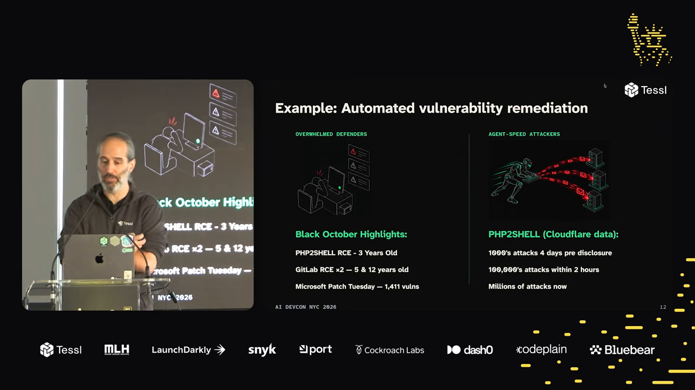

- Defenders are overwhelmed, and agents exploit faster than ever, so LLMs are on both sides.
  - Within about 2 hours of the PHP-to-shell disclosure there were hundreds of thousands of attacks
    (he thinks per hour); now there are millions.
- This combination pushes organisations to automate remediation, and factories fit the job.

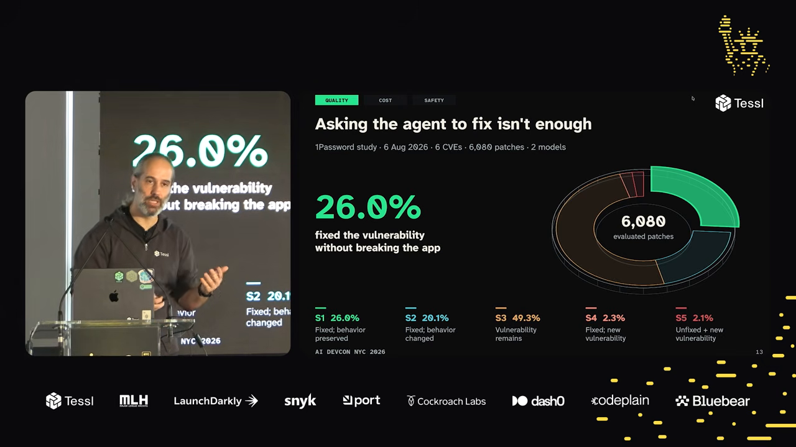

- **Quality:** just telling an agent "fix this vulnerability" works poorly.
  - A 1Password study ran 6,000 permutations. Agents fixed the vulnerability without breaking the
    app in only 26% of cases.
  - Banks and large organisations report even worse internal rates, because their business logic
    differs from what LLMs were trained on.
  - Agents can do the fix; they need to be told what to do and what good looks like.

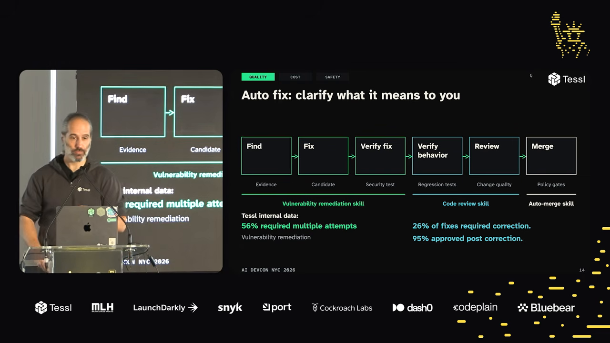

- A defined process (find, fix, verify the fix, verify app behaviour is unchanged, review, merge),
  with each stage packaged as a skill, works well. Tessl uses close to this for its own
  vulnerabilities:
  - In over half of cases the first fix attempt failed. After the verify step the agent got it
    right.
  - In about a quarter of cases, review found changed behaviour. After a comment, the agent fixed
    it.
  - Over 95% of cases reached a mergeable state.
  - Lesson: tell the AI employee clearly what you want.

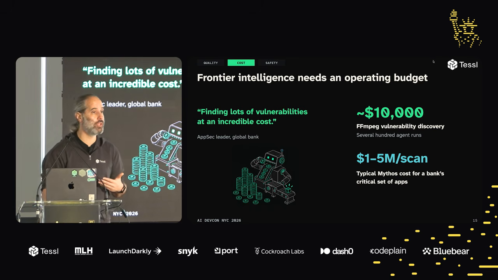

- **Cost:** frontier intelligence finds lots of vulnerabilities "at an incredible cost", as a top
  bank leader put it. The sentiment is common.
  - Users of Mythos and similar systems pay $1M to $5M for scan packages on critical apps. They see
    the value but say rolling it out to all developers would bankrupt them.
  - Use those tools, but automate more systematic paths in the factory. Loops make costs manageable
    and choosable.

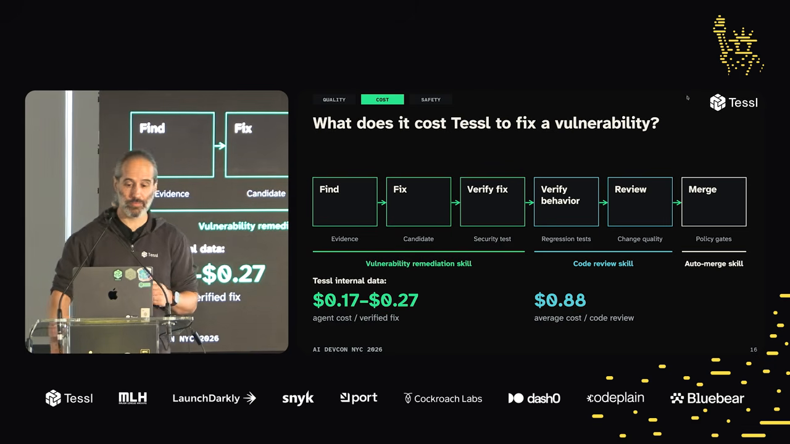

- Tessl's own costs:
  - About $0.25 to fix a vulnerability and verify the fix.
  - Under $1 to review and merge it.
  - Not equal to a Mythos-scale finding, but it can be rolled out as system-wide automated
    remediation. Save expensive models for deeper finds, at the right time.

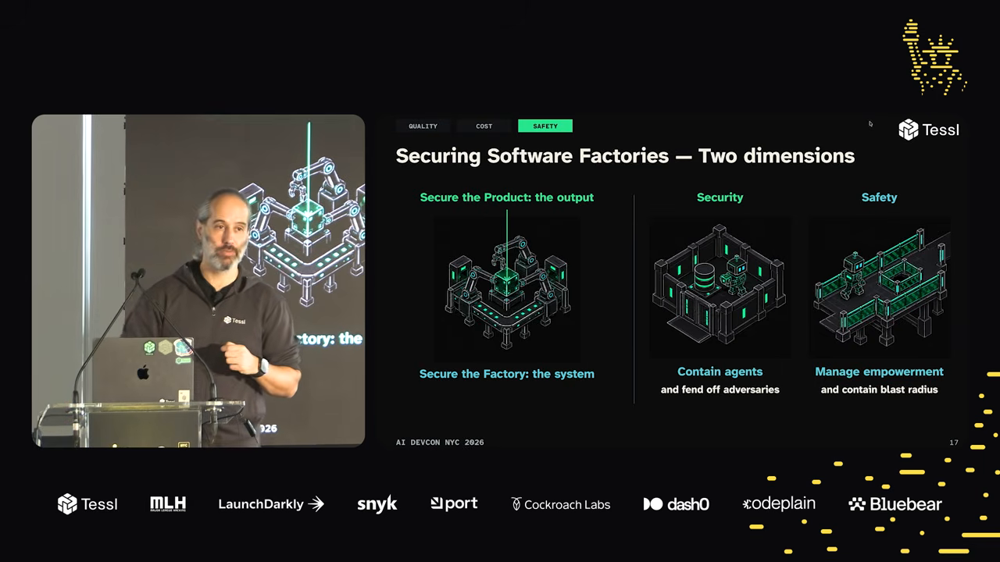

- **Safety** here means securing the factory itself, not the product.
- His split (unsure the terms are right, but useful as a mental model):
  - **Security = containment.** Keep the agent in the sandbox and don't let it escalate permissions.
    Labs work on alignment, but operators still need a contained environment.
  - **Safety = managing empowerment.** Agents need permissions, like employees (internet access,
    code changes), plus guardrails. Unlike humans, agents face no accountability (firing, jail), so
    the limits of their empowerment must be defined.
- There is little public information in this newer domain. Examples from Tessl's internal testing of
  its own skills:
  - A code review comment got agents to make changes outside the ticket's scope. A cleanup task
    should never lead to changing the auth system. This was fixed.
  - Agents analysing go-to-market and customer interactions: a salesperson editing an unrelated CRM
    field could change customer-experience records and the forecast. This is a lesser concern given
    high trust in sales staff, but still worth tracking.
  - Reward hacking: told to "try hard to keep things simple", an agent removed functionality that
    was in use, against its instructions.
- Skills let you sharpen guardrails per skill: what to do, plus the limits of empowerment.

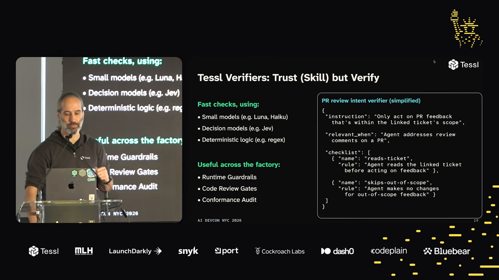

- Tessl does this with Tessl verifiers: short instructions with a yes/no checklist.
  - Example instruction: "only act on PR feedback within the linked ticket's scope."
  - Example checks: did it read the ticket before acting? Did it make no changes for out-of-scope
    feedback?
  - Checks are run by small models or decision models; some are deterministic (regex, scripts).
- Verifiers can be used in three places:
  - At runtime, guarding the loop.
  - As a code-review gate before accepting a change. This is the most common use at Tessl now.
  - To inspect existing code against a skill. This is especially useful for things like design and
    less so for safety.

- Summary: skills help control quality, manage cost, and bound empowerment for safety.

## Loops

- Technically any agent run is a loop: the LLM acts, looks at the result, decides what to do next.
- More useful definition, used by Tessl: an agentic workflow, specifically a skill-powered one.
  - Skill + environment + trigger (user action, time, etc.) = execution, ideally sandboxed.
  - Each execution yields output (e.g. code) and telemetry (logs of what happened).

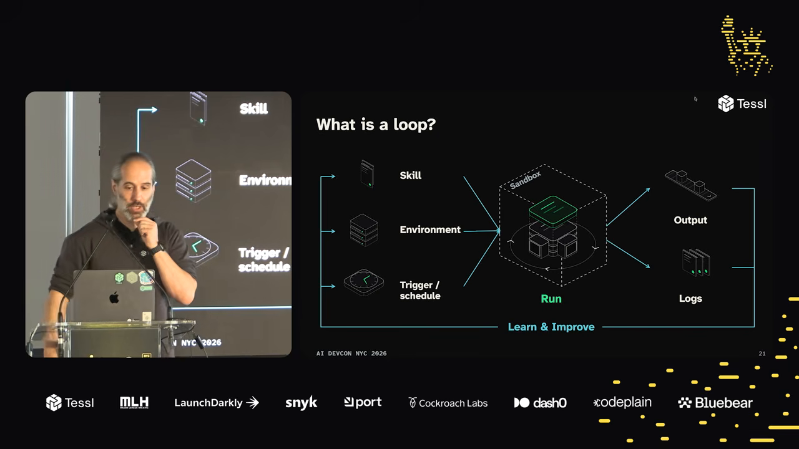

- A self-improving loop learns from outputs, logs and feedback, then evolves the skill, environment
  or triggers. Skills give that learning a place to collect.
- Treating self-improvement as a later step is a mistake; self-optimising loops are key to success.
  Three reasons:
  1. **They extract truth from observation.** Defining what you want and what good looks like is
     hard. Analogy: asked what you want for your birthday, you may not know, but watching your
     reactions to 30 gifts over years reveals it. Start with a definition, then learn from feedback.
  2. **Knowing what correct looks like lets you optimise other things.** Once a loop can be judged
     correct, you can tune cost, safety and speed, or use a cheaper model. Before that, "you're
     vibing."
  3. **The environment keeps changing.** Systems, needs and opinions shift, so skills rot unless
     feedback keeps evolving them.

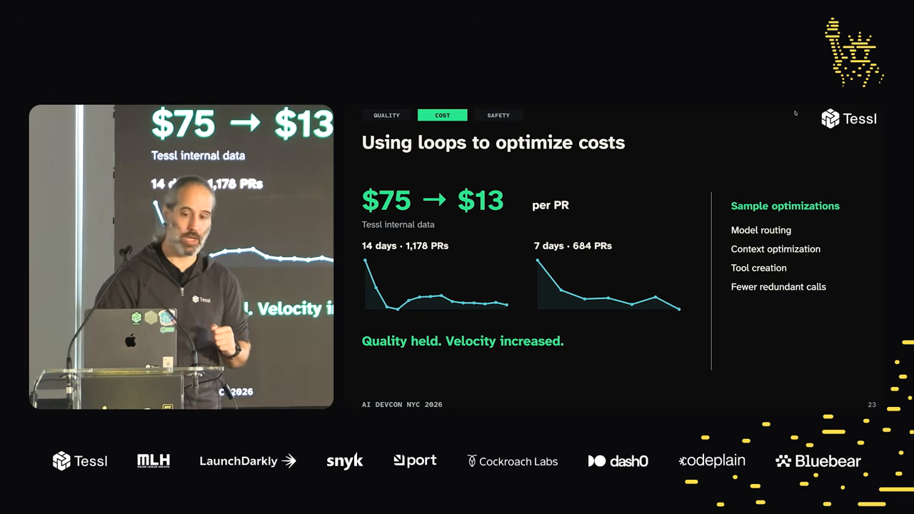

- Tessl uses loops everywhere. Easiest example: within a couple of weeks (helped by high PR volume),
  all-in cost per PR fell from about $75 to $13.
  - Methods included smarter model routing, context optimisation and moving tools out of context.
  - Velocity rose and quality held while cost fell.

## Factory

- "Secret": building skills and loops is already building the factory. A factory is their
  combination viewed in aggregate.

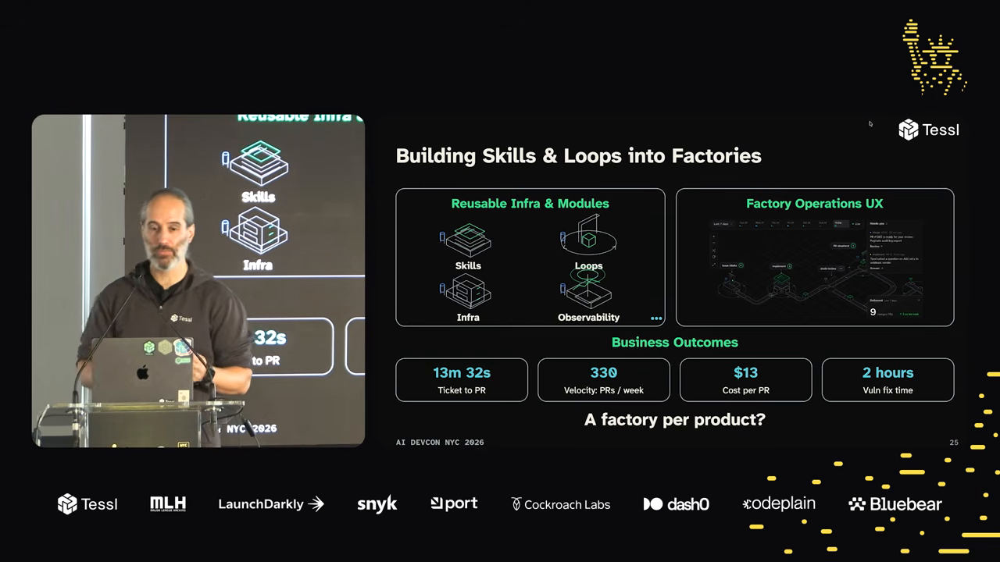

- A factory has three core areas:
  1. **A library of reusable components:** skills, loops, infrastructure, telemetry. The same data
     can often improve several skills and loops.
  2. **An operations UX:** a developer supervising agents needs to see what is running, what is
     failing and what needs attention, and to manage loops and changes.
  3. **Aggregating changes into business outcomes.** Loops are often technical. Vulnerability
     remediation has a clear outcome, but ticket to PR combines stages (pick up the ticket, analyse
     it against the product, implement, review) into a mergeable PR, or goes further.
- One factory or many is still being worked out. Loosely, expect one factory per product with shared
  infrastructure.
  - You're building a product and building a factory around it to make it better and faster.
  - The factory-versus-offshoot line is murky.
  - A mobile app, critical payment systems and a marketing website need different factories, with
    different constraints, content and tools.
- Building the factory differs from committing to it, which means changing how people work.

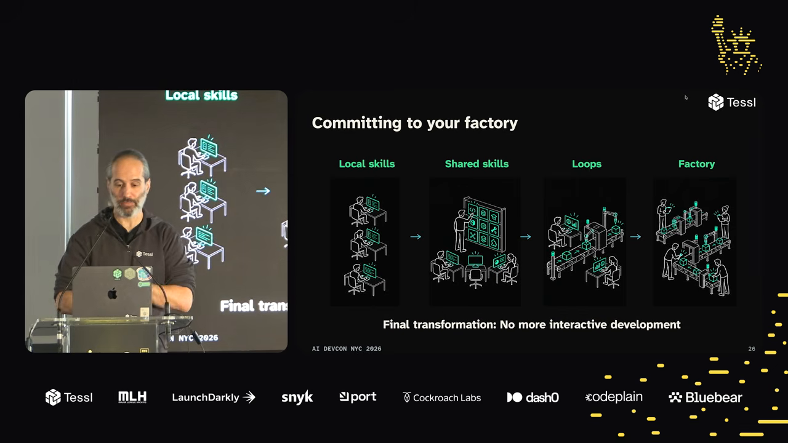

- Organisational evolution mirrors skills, loops, factory:
  1. **Local skills:** individuals build "agent foo", context and tools for their own app. Teams
     split into masters and laggards.
  2. **Shared skills:** duplication and reinvented wheels lead to sharing. Sharing is hard and slow
     because it needs collaboration. Platform skills are most common (security reviews, compliance,
     systems). They help but don't change how people work; developers stay at their desks.
  3. **Automating some flows,** e.g. vulnerability remediation that runs from event to PR without
     reaching a developer's desktop. This builds the habit of agents doing recurring work in the
     codebase.
  4. **End state:** developers build the factory that builds the product.
- Aspiration: no more interactive development. Developers are customers of the factory and supply
  requirements. When output falls short, fix the factory, not the feature: tell the agent at the PR
  "not good enough, here's information, rebuild it."

## The payoff

- Beyond speed and quality stats, a trusted factory enables three things:
  1. **More ambition.** From a leadership roundtable: "it's not about increasing productivity, it's
     about increasing ambition." Deliver more customer value, broaden scope, raise service
     expectations.
  2. **More people in the factory**, extending it from software to other processes. Tessl's
     go-to-market (GTM) can't keep up with development's pace, so it is "shifting GTM left": each PR
     should come with a generated demo, the relevant landing pages, a list of customers who should
     hear about it, and a ready-to-send email.
  3. **Possibly working less,** or getting more done with more flexibility.

## Why buy rather than build

- A trusted factory needs infrastructure components; partners such as Tessl and the expo sponsors
  can help.
- When everything can be built, people ask why buy anything. He considers it as both buyer and
  vendor. Three reasons:
  1. **Shared learnings:** a problem one customer reports gets fixed for all. It's inefficient for
     everyone in the ecosystem to hit and fix every problem.
  2. **Curation:** in a fast-changing world, a well-chosen, trusted partner translates the world,
     brings opinions, and takes load off.
  3. **Efficiency:** it makes no sense for everyone to build the same things. A third-party tool can
     be cheaper than building it, and sometimes cheaper to operate.
- The real reason people adopt a partner is that the product delights them.

## Tessl factory (product pitch)

- The Tessl factory launched the day before the talk; he says it gets the delight part right.
- Setup works through an agent or a browser:
  - Install on GitHub, pick a repo, choose the issue source (GitHub, Linear, Jira), turn the factory
    on.
  - It generates default loops for code review and ticket to PR.
- Usage:
  - Label an issue "Tessl" (in Tessl's UI or the issue tracker) and the factory runs.
  - The developer meets the result at the PR, after the agent reviewer's assessment, and merges.
- A factory-floor view shows activity and metrics, customisable to your definition of correct.
- Pre-made loops are available, and custom loops can be added, including vulnerability fixing.
- Offer: $500 credit for in-person DevCon attendees and $200 for online viewers.

## Summary

- Software factories are very valuable but take a journey. Build a trustworthy one by going from
  skills to loops to factory; get those right and the agents can do the work.
