# All Code Is Slop (Except Mine)

Source: Lauren Tan, AI Engineer, https://www.youtube.com/watch?v=O_zcc6Xl12g

Speaker: Lauren Tan (poteto), Principal Engineer, Grok Bot team at SpaceXSI. The talk was given at
the AI Engineer Code Summit.

## Opening

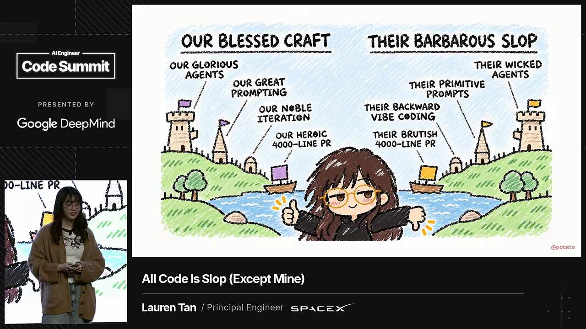

- The talk claims other people's "slop" code can be turned into gold.
- Last month the speaker shipped 3,000 PRs to production. Her monthly count rose from 68 in March to
  3,127 in October, with 10,732 in total (slide).
- Before agents, volume mattered only for outliers. Her previous company called them "coding
  machines", for example Bret Taylor, who reportedly rewrote Google Maps in a weekend. With agents,
  anyone can be one.

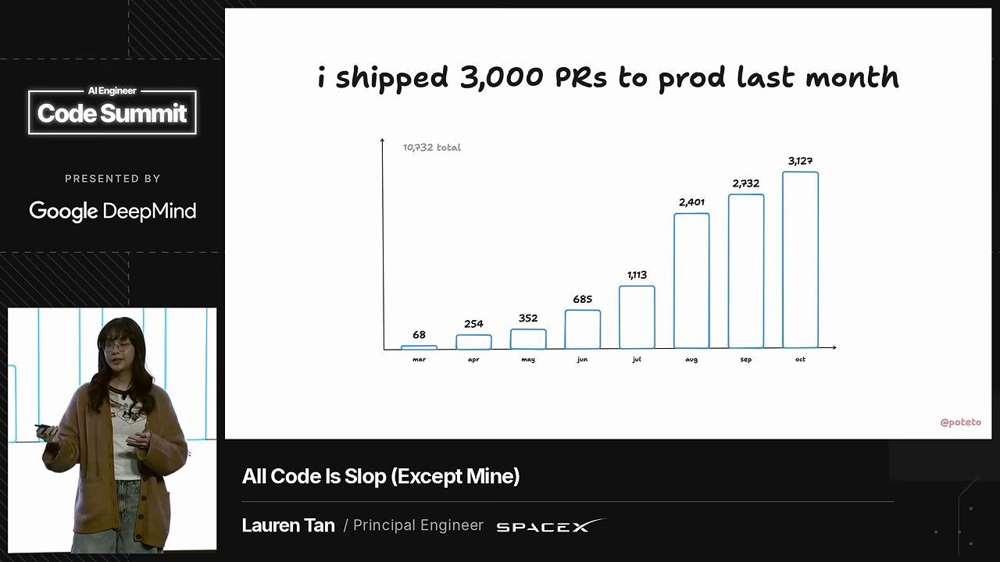

## Thesis: it's about trust

- The engineer's job now is to keep or improve code quality while greatly increasing productivity.
- Some call this a "software factory". She frames it as trust: not blind trust, but investing in the
  agents' environment so they can be relied on to do the right thing.
- Trust rises with the number of agents, from 1 to thousands. The frontier is at thousands (slide).
- It took her 6 months to reach thousands of PRs, many shipped while she slept. She says it will
  take others less time.

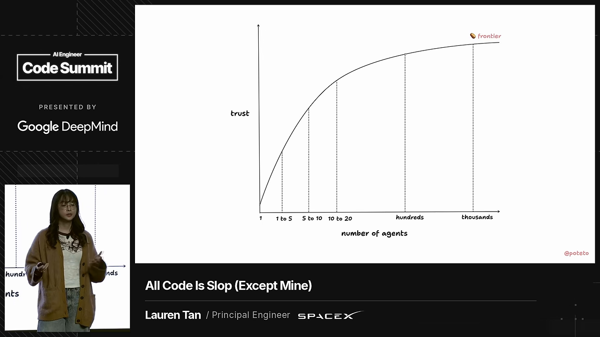

- Low trust: the agent writes slop and a human verifies it. Most people get stuck here.
- High trust: the agent writes good code and an agent verifies it.

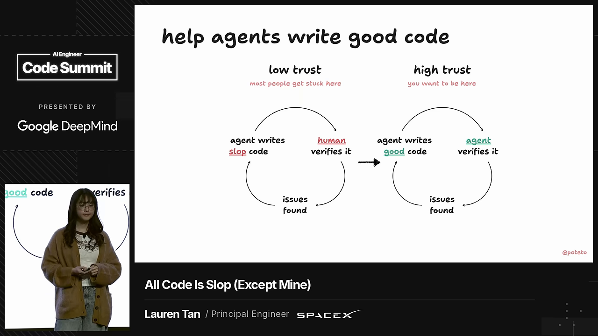

## The inverse pyramid ("the poteto pyramid")

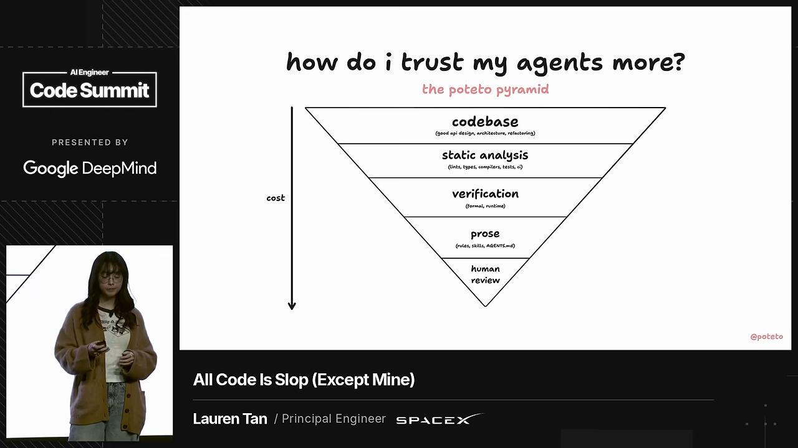

- The pyramid shows where to spend effort on the agent environment. Cost rises toward the bottom.
- The layers, from top to bottom:
  - **Codebase:** API design, architecture, refactoring. Deterministic.
  - **Static analysis:** lints, types, compilers, tests, CI. Deterministic.
  - **Verification:** runtime and formal.
  - **Prose:** rules, skills, AGENTS.md. These need judgement and should be added only a little.
  - **Human review.**
- The two deterministic layers constrain agents and force the right behaviour by default.
- Verification finds bugs, checks properties and invariants, and checks whether the agent understood
  the goals and intent.

## Codebase as input

- Agent outputs depend on their inputs, and the codebase is one of the largest inputs.
- Turn each agent correction into a deterministic check instead of a line in the rules or AGENTS.md.
  Code is more reproducible, so it can be trusted more.
- Garden analogy: in 2024 she reviewed about 3 PRs a day from colleagues; now it is about 300. Each
  engineer is effectively hundreds or thousands of agents, and code arrives as a near-continuous,
  organic stream. Constraints and guardrails are the concrete foundations new code grows around.
  Engineering is becoming gardening.
- Agents copy workarounds, anti-patterns, deprecated code and tech debt because these look like
  established patterns. Each copy makes the next one more likely, and the pattern spreads like
  weeds. Keep the codebase pristine so agents copy good code.

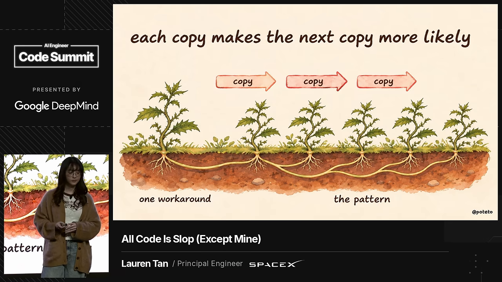

## Examples: Dune

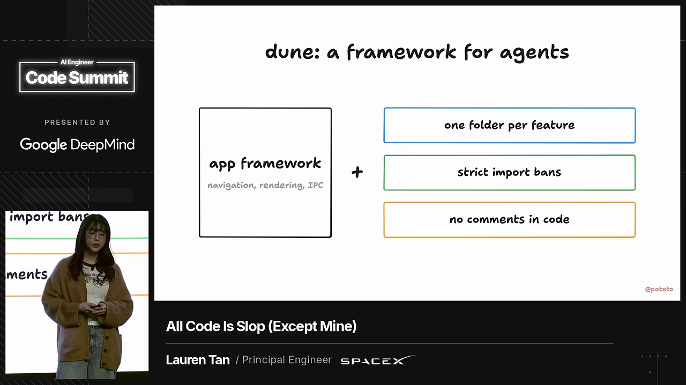

- Dune is a client framework the team built for Grok Bot to put "organic architecture" into
  practice. It is technically unremarkable, roughly "Next.js for Electron apps".
- It is an app framework (navigation, rendering, IPC) plus:
  - one folder per feature
  - strict import bans
  - no comments in code
- It encodes desktop-app lessons as constraints and lint rules.
- Lesson: anything that needs nuance to use well often leads to slop.
  - Example: React `useEffect` is often misused (the "PhD" joke), and agents use it badly. It is
    banned in product code and allowed only in some places inside Dune APIs. This removed the
    problem as a category, so code review no longer has to catch it.
- Directory structure is context:
  - In Cursor, an Electron app, agents often imported main-thread code into the renderer, which
    caused long tasks and jank.
  - Dune has top-level `electron-renderer/` and `electron-main/` directories. Imports between them
    are banned, "not even types", by a dependency graph analyser and lint rules. Shared types go in
    `shared/`.
  - Side project tibo.dog: a `.hot.ts` file suffix (`tick.hot.ts`) signals that the code runs every
    tick and must not allocate (slide).
  - These lint rules are simple to set up and remove one more review concern.

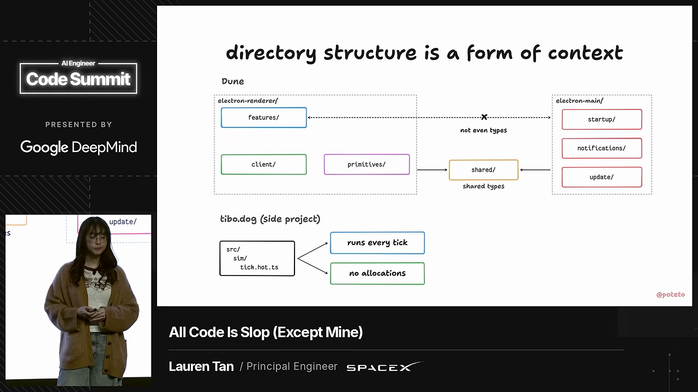

## Markdown and comments as escape hatches

- Agents use Markdown (docs, code comments, rules, skills) to justify not doing the right thing.
- Agents also over-rotate on small corrections and treat them as unbreakable rules.
- Cursor example: agents overused imperative timers (`setTimeout`, `requestAnimationFrame`,
  `requestIdleCallback`) as quick fixes. These patched over a clash between VS Code's imperative
  style and React's declarative style.
  - The architecture choice made both the client and the agents perform worse.
  - Rapidly creating and destroying timers causes major garbage collection, which causes lag and
    jank.
  - Agents wrote comments justifying each fix, and the timers spread. Timeline on the slide:
    - Sep 9: one `setTimeout(..., 0)` fixed a flicker. The agent said a proper fix "would be a
      larger change".
    - Oct 3: the fix was copied into a shared module.
    - Oct 17: there were 183 timers.

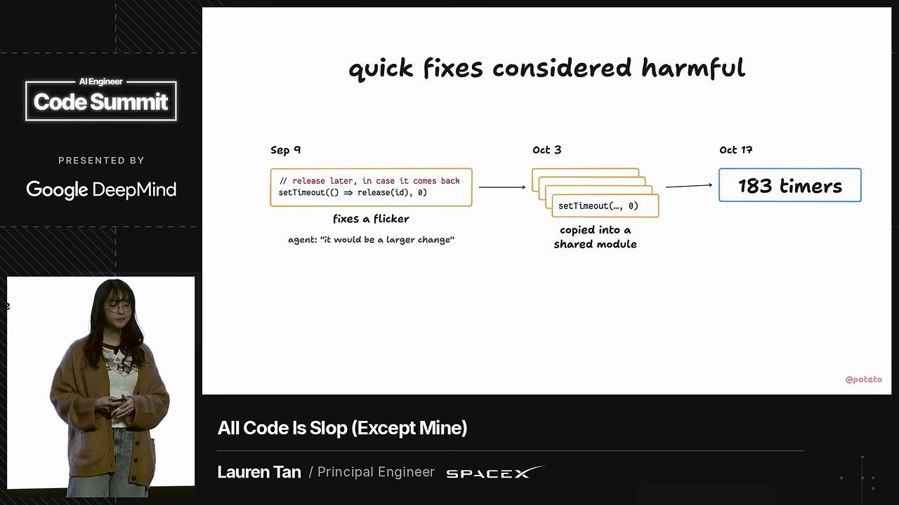

- Grok Bot bans 99% of comments, for these reasons:
  - Comments go stale.
  - Humans rarely read them.
  - They give agents an escape hatch when the right thing is hard.
  - They are not enforceable, so a well-meant note to the next agent can't be trusted.
- Comment count fell from 65,824 (Jul 31) to 1,227 (today) (slide). See also `/no-comments` in
  pstack.

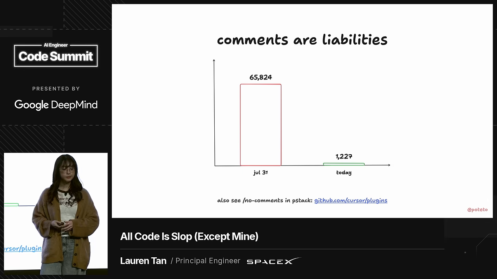

- Grok Bot and Dune lint rules give helpful error messages that tell the agent to fix the root cause
  instead of patching around it.
- General principle: every correction becomes a deterministic check, or the problem is removed as a
  category through better API design or architecture.
- A slide titled "whenever you correct your agent" shows a cumulative count rising from 7 (Jul) to
  167 (Nov), with the advice: "lint against it or categorically eliminate the problem".
- Done often enough, this leaves less to review and eventually nothing. Agents can then merge most
  of their own PRs.

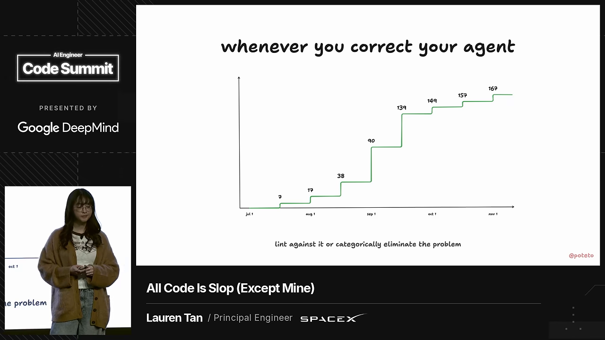

## Verification

- Verification makes agents more autonomous and raises trust in their work. Code review has largely
  shrunk to checking verification artifacts: videos, screenshots, diagrams and formal verification.
- **Runtime verification:** the agent runs the code itself and uses the same debugging tools as
  human developers, such as the Chrome DevTools protocol.
  - The runtime verification skills include a **feature map**, a user-facing site map of app
    features: which features exist, how users reach them, and what proves each works. It gives a
    shared vocabulary, so agents don't have to guess what "the thingy in the left sidebar" means.
  - Custom CLIs inside the skills drive the real app (e.g. `app aria-click`, `app snapshot`,
    `app screenshot`). Agents reuse the CLI and driver each time, which cuts token use, and the CLI
    is testable.
  - See also `/create-verification-skill` in pstack.

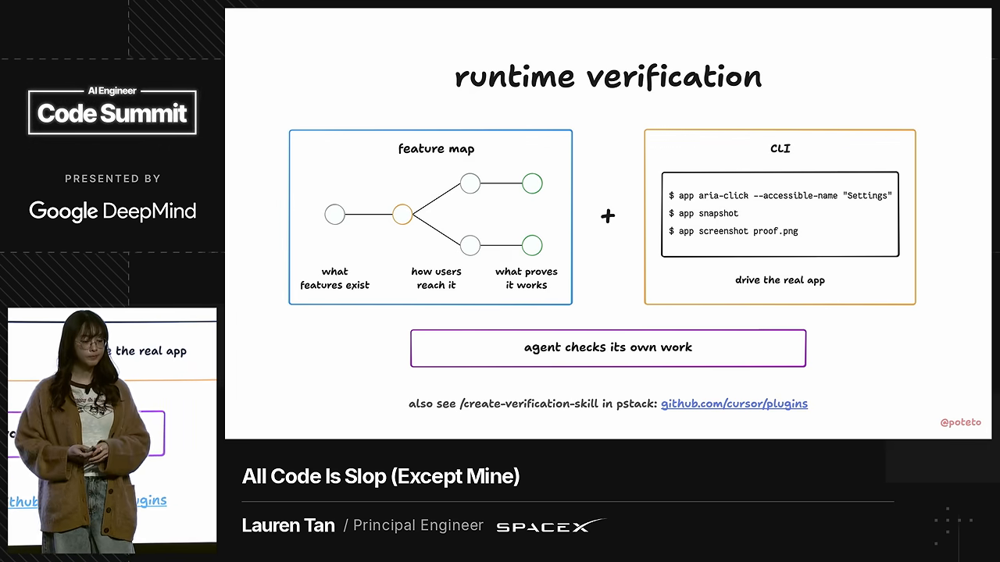

- **Formal verification** (recently adopted):
  - TLA+ model-checks major user flows, such as notifications across multiple devices and platforms.
    It models state machines and checks that all states are handled.
  - Lean proves algorithms. For example, it checks that the team's custom virtualisation library has
    no flickering or jittering.
  - This is still experimental and looks promising. It has already found quite a few bugs, but it is
    "not a silver bullet", just another layer.
  - See also `/create-formal-verification-skill` in pstack.

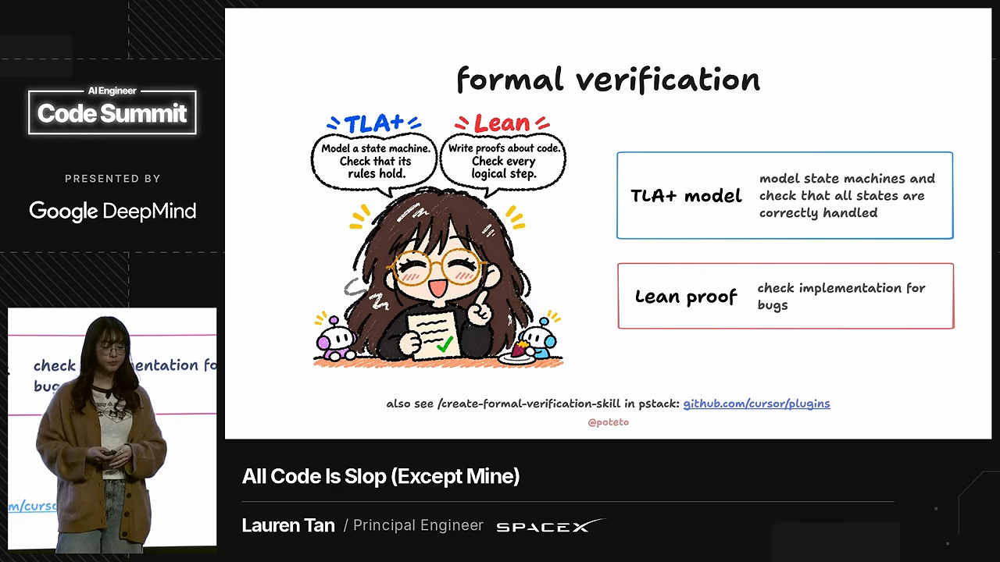

- **Property-based UI testing** (just started): the Bombadil library has already caught a few UI
  bugs.
- Cindy Sridharan:
  - 6 months ago she couldn't trust her agents because subtle bugs were being merged. Verification
    was what was missing.
  - Now 70% of her daily tokens go to verification.
  - The speaker says most of her own tokens also go to verification.
- Cindy Sridharan's list covers pre-production, deploy, release and post-release techniques. None
  are new. They are standard engineering tools that used to be too expensive to understand, write or
  maintain, and agents greatly reduce that cost.

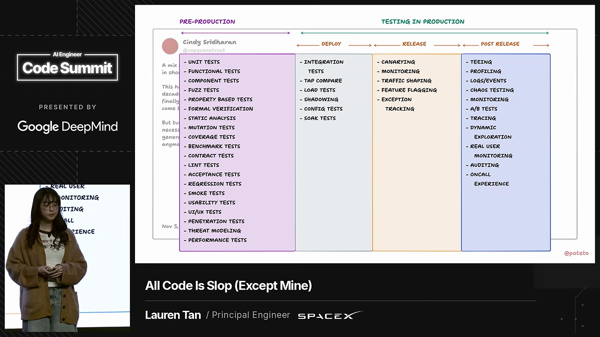

- The speaker calls this "a golden age of software testing and verification": agents make far more
  testing economical.
- Formal verification also helps reason about how the product should work and whether agents
  understand the intent.
- The state chart skill in pstack ("potato stack") visualises state machines from the user's point
  of view. She finds it easier to review alongside videos and screenshots.

## Results ("the promised land")

- Grok Bot team PRs merged per month:

  | Month | PRs merged |
  | ----- | ---------: |
  | Jun   |        809 |
  | Jul   |      1,784 |
  | Aug   |      4,203 |
  | Sep   |      5,648 |
  | Oct   |     10,926 |

  The total is 23,370. The speaker gives October as about 11,000.

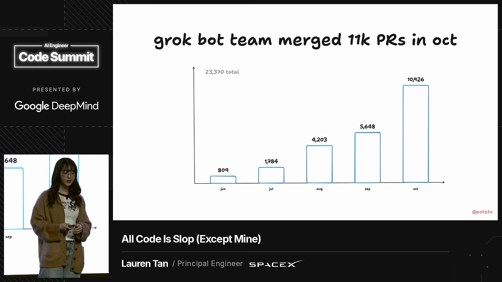

- Desktop app releases per month:

  | Month             | Releases | Median time between releases |
  | ----------------- | -------: | ---------------------------: |
  | Aug (from launch) |        7 |                     44 hours |
  | Sep               |       19 |                     25 hours |
  | Oct               |       15 |                     28 hours |

  A new stable version is cut about once a day.

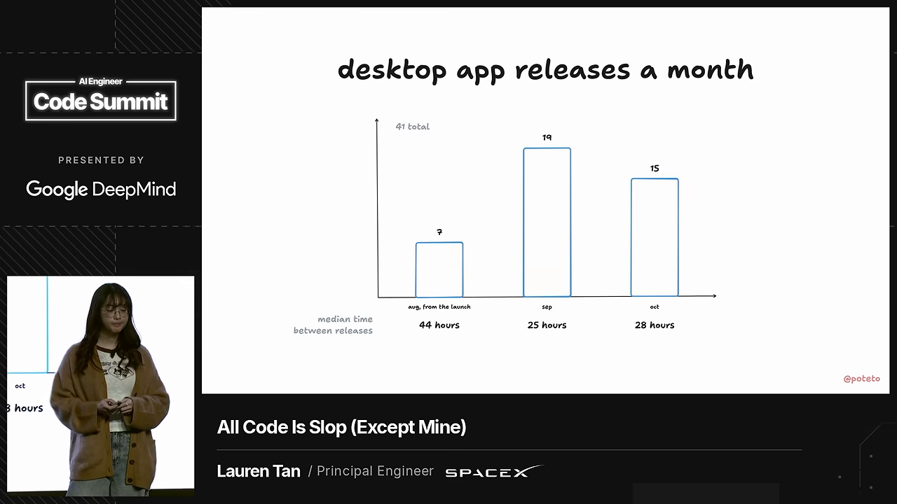

- The core team ships more. There are also more casual and drive-by contributors, who often have
  little context.
- Contributors with at least one PR:

  | Month | Contributors |
  | ----- | -----------: |
  | Jun   |           15 |
  | Jul   |           48 |
  | Aug   |           95 |
  | Sep   |          163 |
  | Oct   |          227 |

  Launch was Aug 11. October breakdown by PRs per person:

  | PRs each | Role     | People |
  | -------- | -------- | -----: |
  | 1,000+   | core     |      1 |
  | 100–999  | core     |     22 |
  | 10–99    | casual   |     77 |
  | 2–9      | drive-by |     78 |
  | 1        | drive-by |     49 |

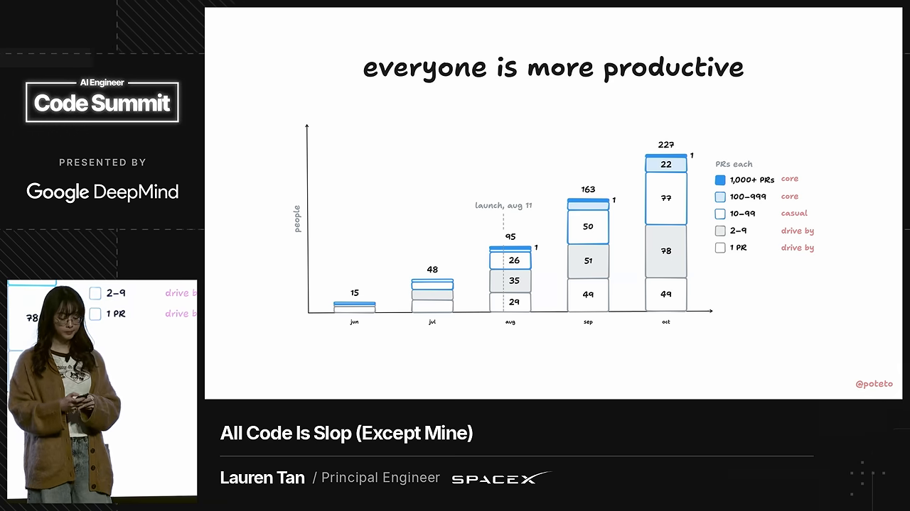

- The share of commits reverted fell and is steady at about 0.5%:

  | Month | Commits reverted |
  | ----- | ---------------: |
  | Jun   |            0.98% |
  | Jul   |            0.61% |
  | Aug   |            0.47% |
  | Sep   |            0.48% |
  | Oct   |            0.47% |

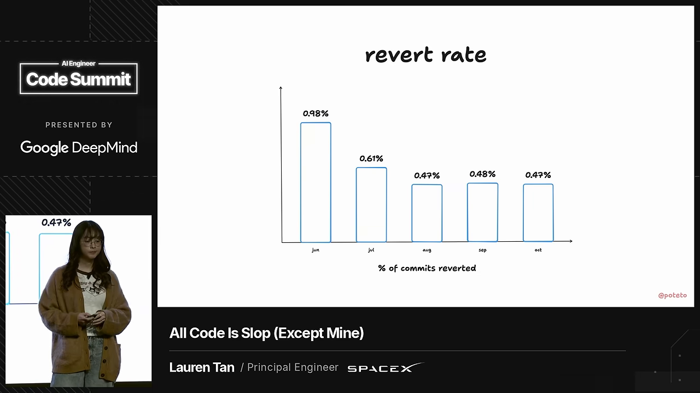

- Performance has improved on several dimensions since launch: startup, typing, opening and
  switching chats.
  - Gains on the slide: cold launch -39%, long-chat typing median and p90 -65%, switching to a short
    chat -44%.
  - Some metrics got worse: memory at idle +12%, idle CPU +100%, window resize +130%, JS+CSS at
    startup +285%, cold-opening a long chat +8%.
- Grok Bot is still an Electron app, so performance has a ceiling. The speaker says it is already
  faster than many other agent UIs, which she considers good given the velocity and number of
  contributors. The slide notes she is "toying with" a Rust rewrite.

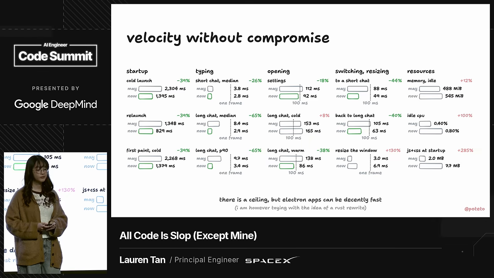

## Advice and the outer loop

- Before building a factory, fix agent corrections by improving the codebase first:
  1. Add a lint rule to block new cases of the anti-pattern.
  2. Clean up existing cases.
  3. Make verification strong.
- This work is a prerequisite to automation anyway. If the inner loop produces slop, automating it
  produces more slop and needs ever more expensive tokens. "Don't automate a bad loop": go from low
  trust to high trust before moving to a "factory", where trust enables scale.

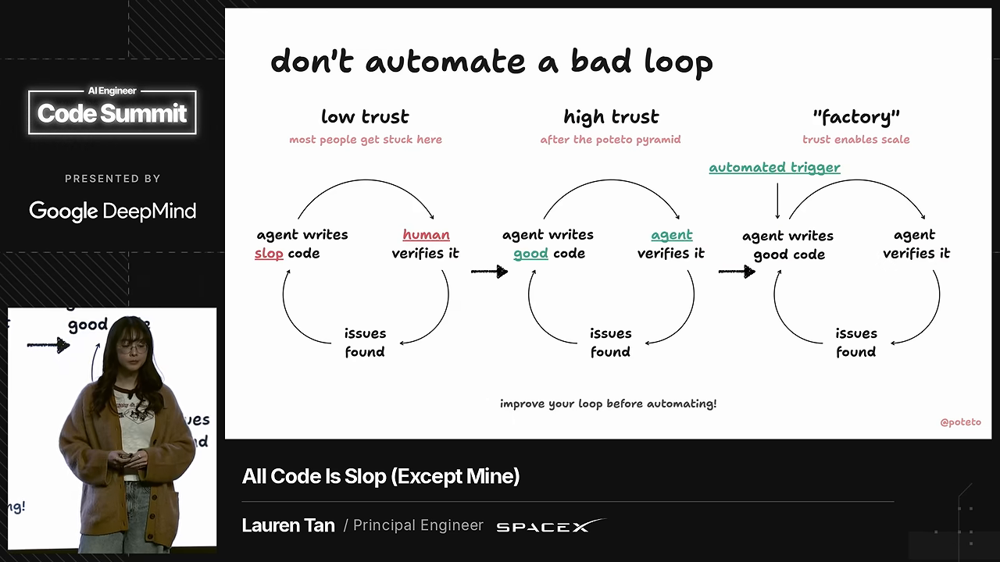

- With the foundations in place (codebase, static analysis, runtime and formal verification), much
  becomes possible, and building a factory on top is easy.
- Grok Bot can act as the outer loop:
  - It has connectors, routines that start Cursor cloud agents, and projects that orchestrate
    hundreds or thousands of agents.
  - Triggers include feedback on X, new Linear tickets, Slack messages, cron schedules and
    Datadog/Sentry alerts.
  - A shared team bot is available to everyone on the team.

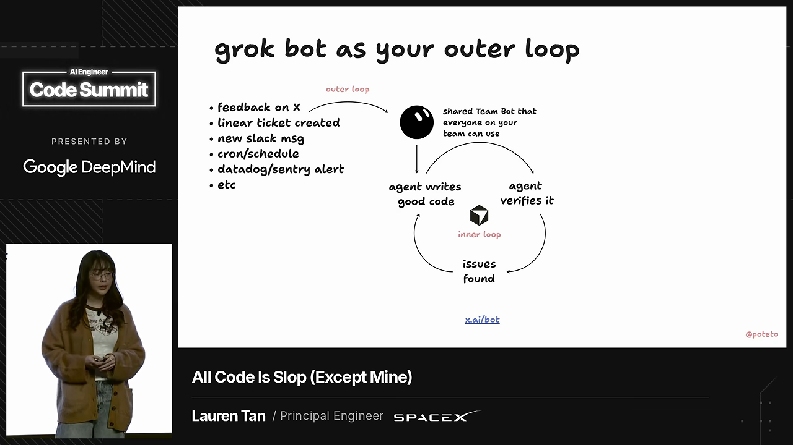

- Example: each release automatically starts a Cursor project. It fuzzes the whole app build by
  using it like a real user, opens a fix PR for each bug found, and auto-merges them.
  - In one sample run there were 50 distinct bugs: 3 new and 47 already existing.
- This works because the codebase is good enough that PRs tend to be good by default. Most product
  code no longer needs deep human review.

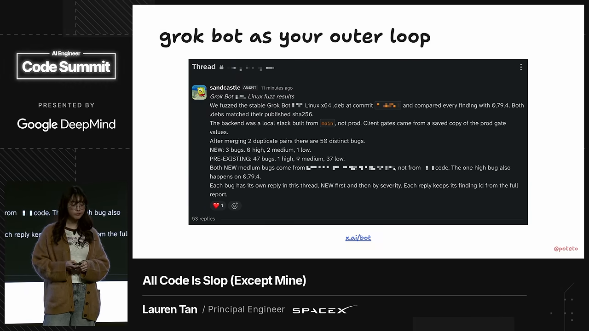

- Conclusion: solid foundations and organic architecture turn slop into gold and allow high velocity
  without compromising quality.
